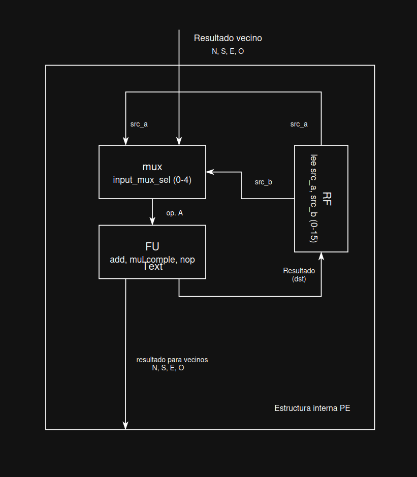

## Estructura interna del PE - Simulador

## RF (Register File)

Banco de registros propio del PE. Tiene entre 2 y 16 posiciones de memoria.

Tiene 2 funciones:

1. __Lectura:__ lee los valores en las posiciones `src_a` y `src_b` que indica la instrucción actual.
2. __Escritura (`RF[dst]`):__ recibe el resultado que calculó la FU y lo guarda en la posición indicada por `dst`.

## Neighbor inputs

Corresponde a los 4 valores que el PE recibe de sus vecinos directos (norte, sur, este y oeste), actualizados cada ciclo por el NoC.

Si un vecino no existe por ejemplo, porque el PE está en el borde de la malla— ese valor llega en `0`.

## Input mux

De acuerdo al valor `0-4`, el mux elige entre leer del RF local (valor `0`) o tomar el valor de uno de los 4 vecinos (valores `1-4`).

Mediante el mux, un PE puede saber lo que calculó otro PE, en vez de depender solo de sus propios datos.

## FU (Functional Unit)

Es la ALU. Toma los dos operandos (A, que ya pasó por el mux; y B, que vino directo del RF) y ejecuta la operación indicada por el opcode de la instrucción (`ADD`, `MUL`, `COMPLEMENT` o `NOP`).

En la ALU:

1. Ocurre el cálculo real.
2. Internamente se dispararía una excepción (`InvalidOperationException`) si el opcode no fuera válido.

## output_value

Es el mismo resultado que se guardó en el registro; también queda expuesto en el PE.

Este es el valor que el NoC va a leer en el siguiente ciclo para repartirlo a los `neighbor_inputs` de los PEs vecinos. Es decir, es la salida "pública" de este PE hacia el resto de la malla, separada del RF (que es privado de cada PE).

## Flujo completo

En cada ciclo, el PE decide de dónde saca el operando A (RF o un vecino); siempre saca el operando B de su propio RF. Calcula con la FU, y el resultado termina en dos lugares a la vez: guardado internamente en el RF, y expuesto hacia afuera como `output_value`, para que sus vecinos lo puedan usar en el ciclo siguiente.

### Diagrama de la estructura

